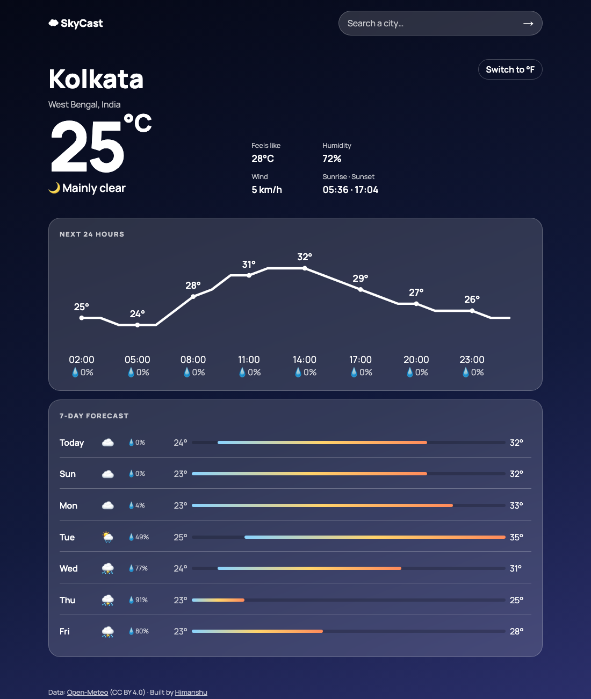

# 🌦️ SkyCast

> A fast, ad-free weather app on the free **Open-Meteo API**. It has city search with disambiguation, geolocation, a server-rendered SVG temperature chart, a 7-day forecast, °C/°F, and a background that changes with the conditions. Built with Express, EJS and axios, and no API key is needed.

**🔗 Live demo:** https://skycast-icru.onrender.com/ *(free tier: the first visit after idle takes ~30–60s to wake up)*

[](https://github.com/himanshuuem/skycast/actions/workflows/test.yml)




## ✨ Features

- **Smart search:** Open-Meteo geocoding. One match redirects straight to the forecast, several matches show a "Did you mean…" list (try *Springfield*), and no match shows a friendly message.
- **Use my location** with the browser Geolocation API as a progressive enhancement. The app works fully without JavaScript.
- **Current conditions** (feels-like, humidity, wind, sunrise and sunset) with WMO weather codes mapped to labels, emoji and day or night.
- **24-hour chart** drawn as **server-side SVG**, with no chart library: a pure `sparkline()` function scales temperatures into the viewBox.
- **7-day forecast** with range bars positioned relative to the week's lowest and highest temperatures, as in Apple Weather.
- **Units toggle** (°C/°F, km/h/mph) and **recent searches** in an httpOnly cookie.
- **Being polite to a free API:** a 10-minute in-memory TTL cache, request timeouts and friendly errors when it's unreachable.
- **Dynamic sky:** the page gradient changes for clear, cloudy, rain, storm, snow, fog and night.

## 🧪 Testing

The weather service takes an **injectable HTTP client**, so the test suite runs fully offline against a fake axios that serves fixtures. It covers redirects, disambiguation, caching, invalid coordinates, the sparkline maths and cookie handling.

## 🚀 Run Locally

```bash
git clone https://github.com/himanshuuem/skycast.git
cd skycast
npm install
npm run dev     # http://localhost:3000
npm test
```

## ☁️ Deploy (free)

`render.yaml` is included. Create a new Blueprint on [Render](https://render.com) and you're done. There are no secrets to configure.

## 📁 Structure

```
skycast/
├── src/
│   ├── server.js
│   ├── app.js            # Routes: /, /search, /weather
│   ├── weather.js        # Open-Meteo client, TTL cache, shaping, sparkline
│   └── weatherCodes.js   # WMO code → label/emoji/theme
├── views/                # home.ejs, weather.ejs, partials/
├── public/               # styles.css, geo.js
└── test/app.test.js      # Offline tests with a fake HTTP client
```

## 📚 Origin

This is my build of **Capstone 3: Use a Public API** from [The Complete Web Development Bootcamp](https://www.udemy.com/course/the-complete-web-development-bootcamp/). Weather data is from [Open-Meteo](https://open-meteo.com/) under CC BY 4.0.

---

Made by [Himanshu](https://github.com/himanshuuem)
